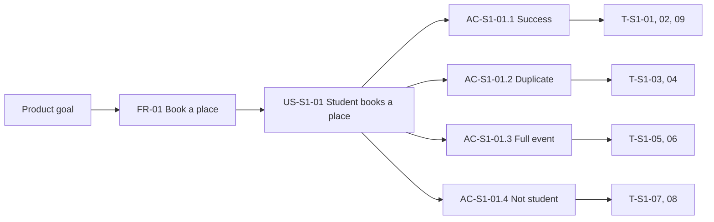
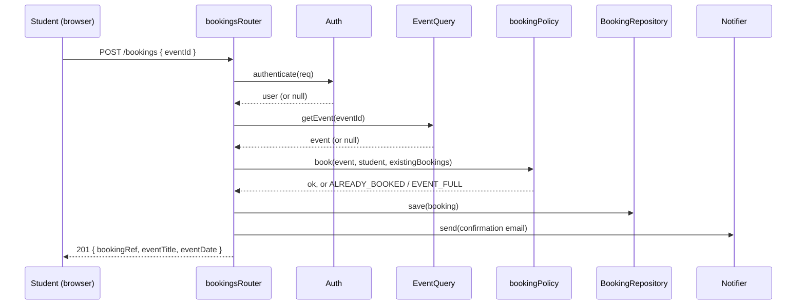

# UniEvents Booking Service

[](https://github.com/essam-eliwa/unievents-booking/actions/workflows/ci.yml)

The **booking slice** of **UniEvents**, a web-based event management system for university students and student societies. This repository implements requirement **FR-01** (booking a place on an event) using a **test-first** approach, with automated tests and a CI pipeline.

It is a teaching example for *Applied Software Engineering* (Sheffield Hallam University). It shows how a single requirement is traced from a product goal, through a user story and acceptance criteria, to automated tests.

---

## Contents

1. [Product goal and scope](#1-product-goal-and-scope)
2. [Requirements](#2-requirements)
3. [Requirements traceability](#3-requirements-traceability)
4. [Getting started](#4-getting-started)
5. [Using the application](#5-using-the-application)
6. [Architecture and design](#6-architecture-and-design)
7. [Testing strategy](#7-testing-strategy)
8. [Continuous integration](#8-continuous-integration)
9. [Contributing workflow](#9-contributing-workflow)
10. [Definition of Done](#10-definition-of-done)
11. [Assumptions and known limitations](#11-assumptions-and-known-limitations)
12. [Troubleshooting](#12-troubleshooting)
13. [Roadmap](#13-roadmap)

---

## 1. Product goal and scope

> For **university students and society organisers** who struggle to find, run and book campus events, **UniEvents** provides a single web platform to publish approved events and manage bookings, so that **events are easy to discover and well attended**. Admin approval and role-based access protect students and the university.

**Success indicators**

- At least 70% of bookings are completed on a first attempt, without help, within one term of launch.
- At least 90% of submitted events are approved or rejected within 2 working days.
- No-shows are reduced by 15% within one term of reminders being introduced.

**Scope of this repository**

| Slice | Status |
|---|---|
| S1 Event booking (this repository) | In scope: book a place, confirmation, duplicate and capacity rules, role checks |
| S2 Event management and approval | Out of scope here (stubbed; see [limitations](#11-assumptions-and-known-limitations)) |
| S3 Accounts and roles | Out of scope here (faked) |
| Cancellation, waiting list, reminders, payments | Future stories (see [roadmap](#13-roadmap)) |

---

## 2. Requirements

### Functional requirement

| ID | Requirement | Priority | Slice |
|---|---|---|---|
| FR-01 | Students book a place on a published event and receive confirmation of the booking | Must | S1 |

### Shared non-functional requirements

| ID | Requirement | Priority |
|---|---|---|
| SNFR-01 | All screens meet WCAG 2.2 level AA | Must |
| SNFR-02 | Personal data is protected; access is role-based; known vulnerabilities in dependencies are not tolerated | Must |

### User story US-S1-01 (Must, 3 points)

> **As a** student, **I want to** book a place on a published event, **so that** I can secure my attendance.

### Acceptance criteria

| ID | Given / When / Then |
|---|---|
| **AC-S1-01.1** | **Given** I am logged in as a student and a published event has places available, **when** I select "Book a place", **then** my booking is saved, a confirmation showing the event title, date and booking reference is displayed, and one confirmation email is requested. |
| **AC-S1-01.2** | **Given** I already have a booking for the event, **when** I try to book it again, **then** no duplicate booking is created and I see "You are already booked on this event". |
| **AC-S1-01.3** | **Given** the event has no places left, **when** I try to book, **then** no booking is created and I see "This event is full". |
| **AC-S1-01.4** | **Given** I am not logged in, or I am logged in with a role other than student, **when** I try to book, **then** no booking is created and I am asked to log in or access is refused. |

---

## 3. Requirements traceability

Traceability chain: **Product goal → Requirement → User story → Acceptance criterion → Test**.



### 3.1 Requirement → story → acceptance criterion → test

| Requirement | Story | Acceptance criterion / NFR | Test ID | Level | Test location | Status |
|---|---|---|---|---|---|---|
| FR-01 | US-S1-01 | AC-S1-01.1 | T-S1-01 | Unit | `tests/bookingPolicy.test.js` | Green |
| FR-01 | US-S1-01 | AC-S1-01.1 | T-S1-02 | API | `tests/bookings.api.test.js` | Green |
| FR-01 | US-S1-01 | AC-S1-01.1 | T-S1-09 | UI (E2E) | `e2e/booking.spec.js` | Green |
| FR-01 | US-S1-01 | AC-S1-01.2 | T-S1-03 | Unit | `tests/bookingPolicy.test.js` | Green |
| FR-01 | US-S1-01 | AC-S1-01.2 | T-S1-04 | API | `tests/bookings.api.test.js` | Green |
| FR-01 | US-S1-01 | AC-S1-01.3 | T-S1-05 | Unit (boundary) | `tests/bookingPolicy.test.js` | Green |
| FR-01 | US-S1-01 | AC-S1-01.3 | T-S1-06 | API | `tests/bookings.api.test.js` | Green |
| FR-01 | US-S1-01 | AC-S1-01.4 | T-S1-07 | API (401) | `tests/bookings.api.test.js` | Green |
| FR-01 | US-S1-01 | AC-S1-01.4 | T-S1-08 | API (403) | `tests/bookings.api.test.js` | Green |
| SNFR-01 | US-S1-01 | WCAG 2.2 AA (page and confirmation state) | T-S1-10 | Accessibility | `e2e/accessibility.spec.js` | Green |
| SNFR-01 | US-S1-01 | WCAG 2.2 AA (keyboard-only booking) | T-S1-11 | Accessibility | `e2e/accessibility.spec.js` | Green |
| SNFR-02 | US-S1-01 | Security headers; no framework disclosure | T-S1-12 | Security | `tests/security.headers.test.js` | Green |
| SNFR-02 | US-S1-01 | No high or critical dependency vulnerabilities | T-S1-13 | Security | CI `audit` job (`npm run audit:ci`) | Green |

### 3.2 Test catalogue

| Test ID | Scenario and input | Expected result |
|---|---|---|
| T-S1-01 | `book()`: capacity 80, booked 79, student has no booking | `ok = true`; booked = 80; reference `BK-nnnn` generated |
| T-S1-02 | `POST /bookings { eventId: "E1" }` as a logged-in student; E1 published, capacity 80, booked 10 | HTTP 201; body has `bookingRef`, `eventTitle`, `eventDate`; one booking stored; notification sent once |
| T-S1-03 | `book()`: student already booked on E1 | `ok = false`; `ALREADY_BOOKED`; booking count unchanged |
| T-S1-04 | `POST /bookings` for E1 twice as the same student | First 201; second 409 "You are already booked on this event"; one booking stored; no second email |
| T-S1-05 | `book()`: capacity 80, booked 80 (boundary) | `ok = false`; `EVENT_FULL`; booked stays 80 |
| T-S1-06 | `POST /bookings` for E2 (80 of 80) as a student | HTTP 409 "This event is full"; no booking stored; no email |
| T-S1-07 | `POST /bookings` with no login | HTTP 401; no booking stored |
| T-S1-08 | `POST /bookings` logged in as an organiser | HTTP 403; no booking stored |
| T-S1-09 | Log in as a student, open E1, select "Book a place" | Confirmation shows title, date and reference; button changes to "Booked" |
| T-S1-10 | axe scan of the booking page before and after booking (WCAG 2.2 A and AA rules) | 0 violations |
| T-S1-11 | Tab to "Book a place" and press Enter | Button receives focus; confirmation shown |
| T-S1-12 | `GET /health` and inspect headers | `X-Content-Type-Options: nosniff`; Content-Security-Policy with `default-src 'self'`; `X-Frame-Options` present; no `X-Powered-By` |
| T-S1-13 | `npm audit --audit-level=high` | No high or critical findings |

### 3.3 Supporting tests (not linked to an acceptance criterion)


| Area | File | Purpose |
|---|---|---|
| Health check | `tests/health.test.js` | The service responds |
| Event endpoints and page | `tests/events.api.test.js` | Event details, 404 `EVENT_NOT_FOUND`, booking page served |
| Unknown event on booking | `tests/bookings.api.test.js` ("extra") | Returns 404 `EVENT_NOT_FOUND` and stores nothing |
| Repository | `tests/inMemoryBookingRepository.test.js` | Save, filter by student, return copies |

---

## 4. Getting started

### Prerequisites

- **Node.js 20 or newer** (`node -v`) and npm
- **Git**
- A modern browser (Playwright downloads its own Chromium for the UI tests)

### Install and run

```bash
git clone https://github.com/essam-eliwa/unievents-booking.git
cd unievents-booking
npm ci
npm start
```

The app starts on <http://localhost:3000>. Set `PORT` to use another port.

### Scripts

| Command | What it does |
|---|---|
| `npm start` | Starts the app with demo wiring (see [limitations](#11-assumptions-and-known-limitations)) |
| `npm test` | Runs the Jest unit and API tests |
| `npm test -- --coverage` | Same, with a coverage report and thresholds |
| `npm run lint` | Runs ESLint |
| `npm run test:e2e` | Runs the Playwright browser tests (first time: `npx playwright install chromium`) |
| `npm run audit:ci` | Fails on high or critical dependency vulnerabilities |

---

## 5. Using the application

With `npm start` running, open these in a browser:

| URL | Expected |
|---|---|
| <http://localhost:3000/health> | `{"status":"ok"}` |
| <http://localhost:3000/events/E1> | Film Society Screening, with a "Book a place" button |
| <http://localhost:3000/events/E2> | Quiz Night (full): booking shows "This event is full" |
| <http://localhost:3000/events/E3> | Careers Fair (79 of 80 places): booking succeeds |
| <http://localhost:3000/events/E99> | "Event not found" |

Because the demo login treats every visitor as the student `stu1`, booking the same event twice shows "You are already booked on this event". Restart the server to reset the data.

### API reference

| Method and path | Purpose | Responses |
|---|---|---|
| `GET /health` | Liveness check | `200 { "status": "ok" }` |
| `GET /api/events/:id` | Event details | `200` event JSON; `404 { "error": "EVENT_NOT_FOUND" }` |
| `GET /events/:id` | Booking page (HTML) | `200` |
| `POST /bookings` | Book a place. Body: `{ "eventId": "E1" }` | `201 { bookingRef, eventTitle, eventDate }`; `401` not logged in; `403` not a student; `404 EVENT_NOT_FOUND`; `409` already booked or event full |

Example:

```bash
curl -i -X POST http://localhost:3000/bookings \
  -H "Content-Type: application/json" \
  -d '{"eventId":"E1"}'
```

---

## 6. Architecture and design

### Project structure

```
.
├── .github/
│   ├── workflows/ci.yml            # lint, test, e2e, audit jobs
│   ├── workflows/weekly-audit.yml  # scheduled dependency audit
│   └── dependabot.yml              # automated dependency update PRs
├── e2e/                            # Playwright UI tests and test server
├── public/                         # booking page (HTML and browser JavaScript)
├── src/
│   ├── app.js                      # createApp(deps): Express app factory
│   ├── bookingPolicy.js            # pure business rules (full, duplicate)
│   ├── bookingsRouter.js           # POST /bookings
│   ├── eventsRouter.js             # GET /api/events/:id
│   ├── inMemoryBookingRepository.js
│   ├── server.js                   # starts the app with demo dependencies
│   └── dev/devDependencies.js      # demo stand-ins for slices S2 and S3
├── tests/                          # Jest tests
│   └── doubles/                    # stub, fake and mock used in tests
├── eslint.config.js
├── playwright.config.js
└── package.json
```

### Design decisions

- **Dependency injection.** `createApp(deps)` receives its event query, authentication, notifier and booking repository. Tests plug in test doubles, and the real slices can be plugged in later without changing the endpoint.
- **Pure business rules.** `bookingPolicy.book()` takes the event, student and existing bookings and returns a result. It has no I/O, so it is fast to unit test.
- **Order of checks** in `POST /bookings`: login (401), role (403), event exists (404), business rules (409). This is why the 401 and 403 tests never touch event data.
- **Security headers** are set with `helmet`, including a Content-Security-Policy that only allows scripts from the same origin.

### Request flow



### Test doubles

| Dependency | Real owner | Test double | Contract |
|---|---|---|---|
| Event query | S2 (events) | `StubEventQuery`: fixtures E1 open (10 of 80), E2 full (80 of 80), E3 last place (79 of 80) | `getEvent(id)` returns an event or `null` |
| Auth and roles | S3 (accounts) | `FakeAuth` (reads `x-test-user` and `x-test-role` headers) | `authenticate(req)` returns `{ userId, role, email }` or `null` |
| Email notification | University email service | `MockNotificationPort` (records calls; no real email is sent) | `send(to, templateId, data)` |
| Booking store | S1 | `InMemoryBookingRepository` | `save()`, `all()`, `findBookingsByStudentId()` |

---

## 7. Testing strategy

Tests are written **before** the code (Red, then Green, then Refactor). The git history shows a failing-test commit before each implementation commit.

| Level | Tool | Examples | Run with |
|---|---|---|---|
| Unit | Jest | `bookingPolicy`, repository | `npm test` |
| API / integration | Jest + supertest | `POST /bookings`, events endpoints, security headers | `npm test` |
| UI / end-to-end | Playwright | Booking journey (T-S1-09) | `npm run test:e2e` |
| Accessibility | Playwright + axe-core | WCAG 2.2 A and AA scan, keyboard-only booking | `npm run test:e2e` |
| Security | supertest, `npm audit` | Security headers, dependency scan | `npm test`, `npm run audit:ci` |
| Static analysis | ESLint | Style and likely mistakes | `npm run lint` |

**Coverage thresholds** (Jest fails the build if they are not met): statements 90%, branches 80%, functions 90%, lines 90%. `src/server.js` and `src/dev/` are excluded.

**Manual checks** (not automated, to be recorded in the portfolio): zoom to 400% with no sideways scrolling, a screen reader pass (NVDA or VoiceOver), and colour contrast review. Automated accessibility scans only find some problems.

---

## 8. Continuous integration

GitHub Actions runs on every push to `main` and on every pull request targeting `main`.

| Job | What it runs | Fails when |
|---|---|---|
| `lint` | `npm run lint` | ESLint reports a problem |
| `test` | `npm test -- --ci --coverage` | A test fails or coverage is below the thresholds |
| `e2e` | Playwright UI and accessibility tests | A browser test fails; the HTML report is uploaded as an artifact |
| `audit` | `npm run audit:ci` | A high or critical dependency vulnerability is found |

Additional automation:

- **Weekly dependency audit** (`weekly-audit.yml`) runs every Monday and can also be run by hand.
- **Dependabot** opens weekly pull requests for npm and GitHub Actions updates, and each one is checked by the pipeline.
- **Node version:** the workflows run on the same Node version the project is developed with. Keep them aligned.

If branch protection is available for the repository, require the `lint`, `test`, `e2e` and `audit` checks before merging.

---

## 9. Contributing workflow

1. Create a branch: `git checkout -b feature/short-description`
2. **Write the failing test first** and commit it (Red).
3. Write the simplest code that passes (Green) and commit it.
4. Refactor with the tests passing.
5. Run everything locally:

   ```bash
   npm run lint
   npm test -- --coverage
   npm run test:e2e
   npm run audit:ci
   ```

6. Push and open a pull request. Wait for all four checks to pass, then merge with a normal merge commit. Do not squash, because the Red and Green history is useful evidence.

Commit messages follow a simple convention: `test:`, `feat:`, `fix:`, `refactor:`, `chore:`, `ci:`, `docs:`.

---

## 10. Definition of Done

A backlog item is done when:

- [ ] Acceptance criteria are written before development and each has at least one test
- [ ] Tests pass locally and in CI (`lint`, `test`, `e2e`, `audit`)
- [ ] Coverage thresholds are met
- [ ] Code is peer reviewed and merged to `main` through a pull request
- [ ] axe scan shows 0 violations on changed pages
- [ ] `npm audit` shows no high or critical vulnerabilities
- [ ] The traceability table in this README is updated (requirement, story, criterion, test, status)

---

## 11. Assumptions and known limitations

| ID | Type | Statement | Impact |
|---|---|---|---|
| A-S1-01 | Assumption | S2 will expose an event query returning status, capacity and booked count | Until then `StubEventQuery` and the demo event list stand in. Contract: `GET /events/{id} → { id, title, date, status, capacity, booked }` |
| A-S1-02 | Assumption | S3 will provide login with a role claim (`STUDENT`, `ORGANISER`, `ADMIN`) on every request | Until then `FakeAuth` (tests) and a demo login (`npm start`) stand in |
| A-S1-03 | Assumption | The university email service accepts one confirmation message per booking | Emails are simulated; the demo notifier only logs to the console |
| C-S1-01 | Constraint | Personal data must not be stored outside the UK | No real personal data is used in tests or demos |

Known limitations:

- **Demo login:** `npm start` treats every visitor as the student `stu1`. The server refuses to start when `NODE_ENV=production` so this cannot be deployed by mistake.
- **In-memory storage:** bookings are lost when the server restarts.
- **Booking references** are derived from the number of stored bookings. A real database should generate unique references.
- **Event data is fixed:** booking an event does not change the "booked" count shown by the demo event service, so the full-event rule is demonstrated by event E2 and covered by unit tests.
- **UI tests** cover the happy path. Duplicate and full-event messages are tested at the API level.

---

## 12. Troubleshooting

| Problem | Fix |
|---|---|
| `npm ci` fails | Run it in the folder that contains `package.json`; check `node -v` is 20 or newer |
| Port 3000 is in use | `PORT=3001 npm start` (PowerShell: `$env:PORT=3001; npm start`) |
| The page says "Event not found" | Use `E1`, `E2` or `E3`; other IDs do not exist in the demo data |
| Playwright cannot find a browser | `npx playwright install chromium` |
| CI passes locally but fails on GitHub | Compare Node versions and check that `package-lock.json` is committed |
| `npm audit` reports vulnerabilities in dev tools | Check `npm audit --omit=dev`, then use `npm audit fix` (never `--force` without review) and see `overrides` in `package.json` |

---

*Created for Applied Software Engineering teaching. 
